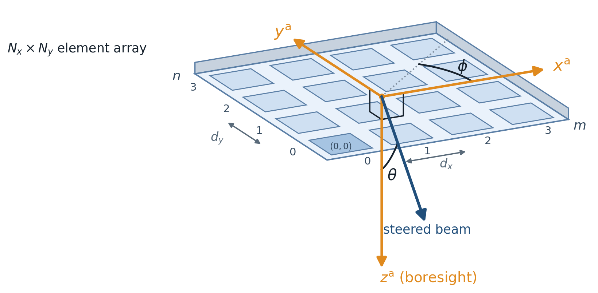
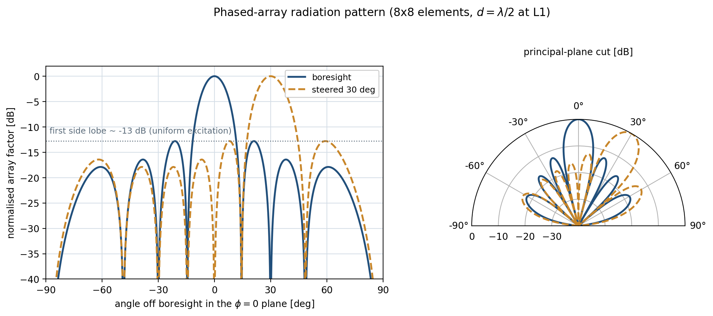
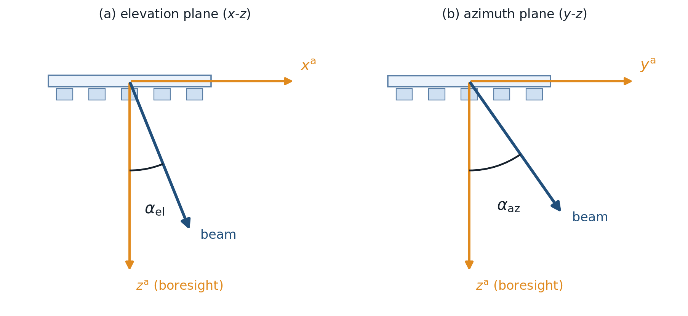

Receiver antenna and pattern generator
======================================

Two modules model the receiver's phased-array antenna.
:class:`~object_definitions.AntennaPatternGenerator_def.AntennaPatternGenerator` computes the radiation
pattern once and writes it to a file; :class:`~object_definitions.Rx_antenna_def.RxAntenna` loads that
pattern and, during a run, returns the antenna gain along whatever direction the receiver is looking.

Pattern generator
-----------------

.. module:: object_definitions.AntennaPatternGenerator_def

Summary
^^^^^^^

A planar phased array forms a directive beam by the coherent superposition of the fields radiated by its
:math:`N_x \times N_y` elements; the geometric part of that superposition -- the interference set by the
element positions and excitation phases -- is the **array factor (AF)**. ``AntennaPatternGenerator``
evaluates the AF over a :math:`(\theta, \phi)` grid for each carrier frequency and each commanded steering
direction and serialises it for reuse.

.. _fig-ant-geometry:

   Geometry of the planar receiver array. The :math:`N_x \times N_y` elements are spaced :math:`d_x`
   and :math:`d_y` in the antenna frame :math:`(x^{\mathrm{a}}, y^{\mathrm{a}})`; the beam is steered to
   a polar angle :math:`\theta` off boresight :math:`z^{\mathrm{a}}` and an azimuth :math:`\phi`. Elements
   are indexed :math:`m = 0 \ldots N_x-1` along :math:`x^{\mathrm{a}}` and :math:`n = 0 \ldots N_y-1` along
   :math:`y^{\mathrm{a}}`, with the reference element :math:`(0,0)` (highlighted) at the near corner.

The array factor
^^^^^^^^^^^^^^^^^

For a planar array with element spacings :math:`d_x, d_y`, define the per-element phase steps -- the phase
increment between adjacent elements along each axis:

.. math::
   :label: ant-psi

   \psi_x = \underbrace{k\,d_x\,\sin\theta\,\cos\phi}_{\text{spatial phase}} + \underbrace{\beta_x}_{\text{steering phase}}, \qquad
   \psi_y = \underbrace{k\,d_y\,\sin\theta\,\sin\phi}_{\text{spatial phase}} + \underbrace{\beta_y}_{\text{steering phase}}.

Here :math:`k = 2\pi/\lambda` is the wavenumber (:math:`\lambda` the wavelength), :math:`\theta` the polar
angle off boresight :math:`z^{\mathrm{a}}`, and :math:`\phi` the azimuth around it. Each step is the sum of
two contributions:

- the **spatial (geometric) phase** :math:`k\,d\,\sin\theta\,\cos\phi` (and :math:`\sin\phi` for the
  :math:`y` axis) -- the path-length phase difference between adjacent elements for a plane wave in direction
  :math:`(\theta, \phi)`, fixed by the array geometry; and
- the **steering phase** :math:`\beta_x, \beta_y` -- the progressive phase applied electronically to point
  the beam, set in the :ref:`Steering <ant-steering>` section (:eq:`ant-beta`).

The array factor is the product of the two per-axis sums over all elements, where :math:`m = 0 \ldots N_x-1`
and :math:`n = 0 \ldots N_y-1` index the elements along :math:`x^{\mathrm{a}}` and :math:`y^{\mathrm{a}}` and
:math:`N_x, N_y` are the number of elements per axis,

.. math::
   :label: ant-af

   \mathrm{AF}(\theta,\phi) = \left(\sum_{m=0}^{N_x-1} e^{j m \psi_x}\right)
   \left(\sum_{n=0}^{N_y-1} e^{j n \psi_y}\right),

In the beam direction the element contributions are co-phased and the AF attains its maximum
:math:`|\mathrm{AF}|_{\max} = N_x N_y`, the **coherent array-combining factor** (the broadside field
relative to a single element). This maximum is governed by the element count alone: the spacing
:math:`d_x, d_y` sets the beamwidth and the grating-lobe geometry, not the peak amplitude. It is a *relative*
field maximum, not a directivity -- the absolute scale enters only through the radiated-power normalisation
of :ref:`ant-gain`.

The elements are **uniformly excited** (unit amplitude, no aperture taper), which gives the narrowest main
beam for a given aperture but bounds the side-lobe suppression. With uniform excitation the first side-lobe
level depends on the array size -- higher (less suppressed) for small arrays -- and decreases toward an
asymptotic floor of :math:`\approx -13.3` dB as the array grows large (the limit of a uniformly illuminated
continuous aperture).
Adding elements narrows the beam but cannot drive the first side lobe below this floor;
lowering it requires an amplitude taper, which is not modelled in this antenna model. :numref:`Fig. %s <fig-ant-pattern>`
shows a representative principal-plane cut for one array configuration. The stored quantity is the *relative*
power pattern :math:`20\log_{10}|\mathrm{AF}|`, normalised so its peak is 0 dB; the absolute gain in dBi is
recovered later from the directivity (:ref:`ant-gain`).

.. note::

   The sums in :eq:`ant-af` are **0-based** (:math:`m = 0 \ldots N_x-1`, :math:`n = 0 \ldots N_y-1`), matching
   the implementation where ``numpy.arange`` enumerates the elements (:numref:`Fig. %s <fig-ant-geometry>`).
   This is identical to the **1-based** convention with exponent :math:`e^{j(m-1)\psi_x}` used in much of the
   antenna literature (e.g. Balanis): both place the corner element at the phase reference, so the element
   phases :math:`\{0, \psi, 2\psi, \ldots, (N_x-1)\psi\}` -- and hence the array factor -- are the same. Only
   the index label shifts; substituting :math:`m' = m-1` maps one form onto the other.

.. _fig-ant-pattern:

   Example principal-plane (:math:`\phi = 0`) array-factor cut, normalised to a 0 dB peak, for a boresight
   beam and a beam steered to :math:`30^\circ`; steering the progressive phase only slides the main lobe
   along the axis. Generated by ``ARCHITECTURE/make_antenna_pattern.py`` from the simulator's own
   ``ArrayFactor`` for an illustrative :math:`8 \times 8` half-wavelength array at the L1 carrier (the
   side-lobe level shown is specific to this array size).

.. _ant-steering:

Steering
^^^^^^^^

The beam is pointed by the progressive inter-element phases :math:`\beta_x, \beta_y`: a linear phase ramp
across the aperture tilts the in-phase direction off boresight. **Elevation** :math:`\alpha_\mathrm{el}`
tilts the beam about the :math:`y`-axis (the peak moves along :math:`x^{\mathrm{a}}`, the flight direction)
and **azimuth** :math:`\alpha_\mathrm{az}` about the :math:`x`-axis (peak along :math:`y^{\mathrm{a}}`), so
the phases are set to

.. math::
   :label: ant-beta

   \beta_x = -k\,d_x\,\sin\left(\alpha_\mathrm{el}\right), \qquad
   \beta_y = -k\,d_y\,\sin\left(\alpha_\mathrm{az}\right),

which cancels the spatial phase term in :eq:`ant-psi` along the commanded direction so every element adds in
phase there. Using this two-plane (sine-space) steering, the beam points along the **unit vector** :math:`\hat{d}`, whose
Cartesian components in the antenna frame :math:`(x^{\mathrm{a}}, y^{\mathrm{a}}, z^{\mathrm{a}})` are

.. math::
   :label: ant-steer

   \hat{d}
   = \begin{pmatrix} d_{x^{\mathrm{a}}} \\ d_{y^{\mathrm{a}}} \\ d_{z^{\mathrm{a}}} \end{pmatrix}
   = \begin{pmatrix}
       \sin\alpha_\mathrm{el} \\[2pt]
       \sin\alpha_\mathrm{az} \\[2pt]
       \sqrt{1 - \sin^2\alpha_\mathrm{az} - \sin^2\alpha_\mathrm{el}}
     \end{pmatrix}.

Equivalently :math:`\hat{d} = \sin\alpha_\mathrm{el}\,\hat{x}^{\mathrm{a}} + \sin\alpha_\mathrm{az}\,\hat{y}^{\mathrm{a}}
+ \sqrt{1-\sin^2\alpha_\mathrm{az}-\sin^2\alpha_\mathrm{el}}\;\hat{z}^{\mathrm{a}}`. The :math:`x` and :math:`y`
components are the steering direction cosines; the boresight (:math:`z`) component is fixed by the
unit-length condition :math:`|\hat{d}| = 1`. For that component to be real the steering angles must satisfy
:math:`\sin^2\left(\alpha_\mathrm{az}\right) + \sin^2\left(\alpha_\mathrm{el}\right) \le 1` or the
beam would point below the horizon (the constructor rejects sweeps that break this);
:numref:`Fig. %s <fig-ant-steering>` shows these two angles. Half-wavelength element
spacing (:math:`d \le \lambda/2`) keeps grating lobes out of the visible region across the steering range.

.. _fig-ant-steering:

   Two-plane steering angles. In each principal plane the steering angle is measured directly from boresight
   :math:`z^{\mathrm{a}}` -- *(a)* **elevation** :math:`\alpha_\mathrm{el}` in the :math:`x`-:math:`z` plane
   (rotation about :math:`y`; the peak moves along :math:`x^{\mathrm{a}}`, the flight direction) and *(b)*
   **azimuth** :math:`\alpha_\mathrm{az}` in the :math:`y`-:math:`z` plane (rotation about :math:`x`) -- so
   that :math:`\sin\alpha_\mathrm{el}` and :math:`\sin\alpha_\mathrm{az}` are the :math:`x` and :math:`y`
   direction cosines of the beam (:eq:`ant-steer`). A general command applies both at once; the combined
   angle off boresight is the polar angle :math:`\theta` of :numref:`Fig. %s <fig-ant-geometry>`, with
   :math:`\sin\alpha_\mathrm{el} = \sin\theta\cos\phi` and :math:`\sin\alpha_\mathrm{az} = \sin\theta\sin\phi`.

Pattern storage and caching
^^^^^^^^^^^^^^^^^^^^^^^^^^^^^

Evaluating the AF over the full :math:`(\theta, \phi)` grid for every steering command and carrier frequency
is the costly step, so the generator computes each pattern **once** and serialises it to JSON rather than
recomputing it on every run. One file is written per *(steering azimuth, steering elevation, carrier
frequency)* triple, named ``array_factor_<f>MHz_<az>az_<el>el.json``; it stores the normalised pattern
:math:`20\log_{10}|\mathrm{AF}_n|` sampled on the :math:`\theta \in [0^\circ, 180^\circ]`,
:math:`\phi \in [0^\circ, 360^\circ)` grid (``theta_resolution`` :math:`\times` ``phi_resolution`` samples)
together with its steering and frequency metadata. The steering grid is swept per axis from
``azimuth_steering`` / ``elevation_steering`` (``[start, end, n_steps]``) and always includes the boresight
command :math:`(0^\circ, 0^\circ)`. A separate set is produced per band, since the electrical spacing
:math:`k d = 2\pi d / \lambda` -- and therefore the pattern -- depends on the carrier frequency.

Regeneration is gated by a signature file (``antenna_pattern_metadata.json``) recording every
pattern-affecting parameter: element counts, spacings, frequency list, steering sweeps, angular resolutions,
and a generator format version. On start-up the patterns are regenerated only if the signature has changed
or files are missing; otherwise the cached JSONs are reused unchanged. ``RxAntenna`` loads this set and
interpolates over it at run time (:ref:`ant-gain`).

.. autoclass:: object_definitions.AntennaPatternGenerator_def.AntennaPatternGenerator
   :no-members:

.. autoclass:: object_definitions.AntennaPatternGenerator_def.ArrayFactor
   :members:

Receiver antenna
----------------

.. module:: object_definitions.Rx_antenna_def

Summary
^^^^^^^

``RxAntenna`` is the run-time antenna. It loads the generated patterns and, given a look direction in the
antenna frame, returns the gain there. The receiver auto-steers to each reflection, so the gain it reports
is the steered-beam value used in the link budget. It also owns the **footprint** -- the ground area inside
a chosen gain contour (``footprint_dB``, e.g. -1 dB) -- which sets the illuminated area for distributed
targets.

.. list-table:: Key public methods
   :widths: 44 56
   :header-rows: 1

   * - Method
     - What it does
   * - ``get_gain_dbi_for_direction(direction, frequency_mhz, ...)``
     - Gain [dBi] along a look direction (optionally at a given steering).
   * - ``resolve_steering_angles_for_direction(direction)``
     - The azimuth/elevation steering that points the beam at a direction (or ``None`` if unreachable).

.. _ant-gain:

Absolute gain and scan loss
^^^^^^^^^^^^^^^^^^^^^^^^^^^^^

The link budget needs an absolute gain in dBi, not the 0 dB-normalised pattern. ``RxAntenna`` recovers it
from the **directivity** of the steered beam, obtained by integrating the normalised power pattern over the
sphere,

.. math::
   :label: ant-directivity

   D = \frac{4\pi}{\displaystyle\oint \left|\mathrm{AF}_n(\theta,\phi)\right|^2\, d\Omega},
   \qquad d\Omega = \sin\theta\;d\theta\,d\phi,

with :math:`\mathrm{AF}_n = \mathrm{AF}/|\mathrm{AF}|_{\max}` the array factor normalised to unit peak. For the
uniform excitation used here :math:`|\mathrm{AF}|_{\max} = N_x N_y` (:eq:`ant-af`), so
:math:`\mathrm{AF}_n = \mathrm{AF}/(N_x N_y)` and equivalently
:math:`D = 4\pi\,(N_x N_y)^2 / \oint |\mathrm{AF}|^2\, d\Omega`. The gain along a look direction
:math:`\hat{r}` is then the directivity of the commanded beam plus the relative pattern there,

.. math::
   :label: ant-gain-eq

   G(\hat{r})\;[\mathrm{dBi}] = D(\alpha_\mathrm{az}, \alpha_\mathrm{el})\;[\mathrm{dBi}]
   + 20\log_{10}\left|\mathrm{AF}_n(\hat{r})\right|.

Because :math:`D` is evaluated from the *steered array factor*, its idealised scan dependence is captured:
tilting the beam changes the solid-angle integral and normally lowers peak directivity. Element-pattern
scan loss, impedance mismatch, mutual coupling, finite ground plane and radome effects are not included.
In practice the gain is bilinearly interpolated, in linear power, across the four stored steering patterns
bracketing the commanded direction.

.. note::

   **Spacing dependence of the directivity.** The combining factor :math:`|\mathrm{AF}|_{\max} = N_x N_y`
   (:eq:`ant-af`) is fixed by the element count and is independent of :math:`d_x, d_y`. The directivity is
   not that maximum but the peak-to-mean of the power pattern,
   :math:`D = 4\pi\,|\mathrm{AF}|_{\max}^2 / \oint|\mathrm{AF}|^2\,d\Omega` (equivalently :eq:`ant-directivity`),
   in which the spacing enters only through the denominator -- the radiated power, i.e. the pattern shape.
   For a one-sided uniformly illuminated aperture, the standard reference approximation is

   .. math::
      :label: ant-aperture

      D \approx \frac{4\pi}{\Omega_A} \approx \frac{4\pi\,A_\mathrm{ap}}{\lambda^2},
      \qquad A_\mathrm{ap} = (N_x d_x)(N_y d_y),

   so broadside directivity tracks aperture area until grating lobes appear. The implemented isotropic
   planar array is **two-sided**: its array factor has equal front and rear lobes and the full-sphere
   integral includes both. Thus the one-sided aperture formula is a scale reference, not an exact
   prediction for this model. Runtime geometry rejects rear-hemisphere looks, but that does not remove
   rear-lobe power from the directivity normalization.

.. autoclass:: object_definitions.Rx_antenna_def.RxAntenna
   :no-members:

Module Assumptions and Limitations
----------------------------------

- **Ideal isotropic elements and equal backlobe.** The pattern is the array factor only, so a planar array
  radiates equal lobes into the front and rear hemispheres. Runtime look-direction gating rejects the
  rear hemisphere, while directivity still includes its radiated power. A real element pattern,
  ground plane, radiation efficiency, mismatch, mutual coupling and radome are absent; absolute gain
  therefore remains an idealised value.
- **Sine-space steering limit.** Steering is bounded by ``sin^2(az) + sin^2(el) <= 1``; sweeps beyond that
  are rejected.
- **Patterns are generated, then cached.** ``RxAntenna`` consumes whatever files the generator wrote; a
  changed array geometry needs the patterns regenerated.
- **Pattern peak normalised to 0 dB.** The footprint contour must be below 0 dB.
- **Geographic footprint polygons.** Ray/surface intersections are converted directly to longitude and
  latitude before building a Shapely polygon. Footprints crossing the antimeridian are not unwrapped and
  can be represented incorrectly.

Validation and Tests
--------------------

.. list-table::
   :widths: 44 56
   :header-rows: 1

   * - Test module
     - What it pins
   * - ``tests/test_antenna_gain_golden.py``
     - Golden-file regression of the gain pipeline (reference in ``tests/golden/reference_gains.npz``;
       regenerate via ``tests/golden/regenerate_gains.py``), plus steering-axis convention and invalid
       generator-input checks. A golden file detects code changes; it is not chamber calibration.
   * - ``tests/antenna_fixture.py``
     - Shared lightweight antenna fixture used across the suite.

User Guide
----------

The array is configured in two INI sections:

- ``[ANTENNA PATTERN]`` -- the array geometry that drives the generator: ``elements_along_x`` /
  ``elements_along_y``, ``d_x`` / ``d_y`` (element spacing; commonly about half a wavelength to avoid grating lobes), the
  ``azimuth_steering`` / ``elevation_steering`` sweeps, and ``theta_resolution`` / ``phi_resolution``.
- ``[ANTENNA]`` -- what the receiver uses: ``polarizations`` (``["RHCP", "LHCP"]``), ``bands``, and
  ``footprint_db`` (the footprint contour level).

When ``[ANTENNA PATTERN]`` is present the patterns are (re)generated before the run; otherwise the cached
files are reused.

References
----------

- Balanis, C. A., *Antenna Theory: Analysis and Design*, 4th ed., Wiley, 2016 (array factor, planar arrays).
- Mailloux, R. J., *Phased Array Antenna Handbook*, 3rd ed., Artech House, 2017.
