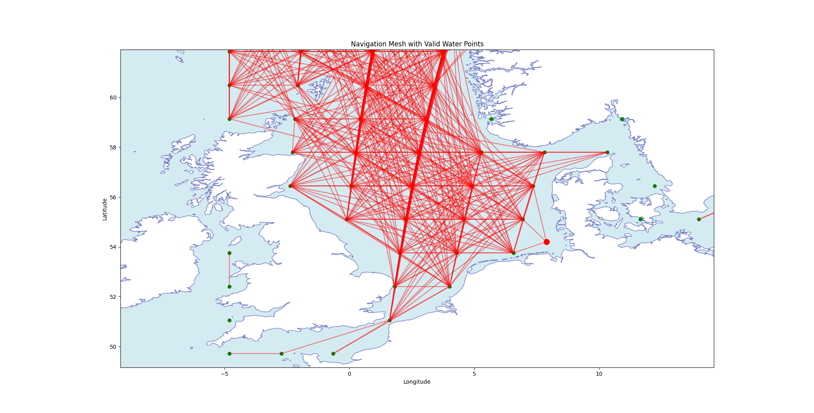

Ship trajectory
===============

.. module:: object_definitions.ShipTrajectory_def

Summary
-------

``ShipTrajectory`` builds a ship's route from a start point, an end point, a start time, and a speed.
The route stays on water and is time-stamped: it is a list of ``(timestamp, latitude, longitude)`` samples.
The moving-target detector (:class:`~object_definitions.MovingTargetDetection_def.MovingTargetDetection`)
reads these samples to place the target at each time step.

The route is planned on a **navigation mesh** -- a graph of points on the sea. The points come from an
ocean-polygon shapefile (:data:`Constants.earth_coastline_path`; `Natural Earth <https://www.naturalearthdata.com/>`_ ``ne_10m_ocean.shp`` by
default, though any water-polygon layer works -- see the assumptions below). Points that fall on water
become graph nodes, and two nodes are linked when the straight line between them stays on water. The
shortest path across this graph is the route (found with ``networkx``). A start or end point on land is
moved to the nearest water. The finished route is simplified, sampled at a fixed time step, and saved to
disk, so an unchanged run loads it back instead of planning it again.

Interface
---------

.. list-table:: Inputs / outputs
   :widths: 12 26 48 14
   :header-rows: 1

   * -
     - Variable
     - Description
     - Unit
   * - **Inputs**
     - ``ship_id``
     - Identifier used for the shapefile / cache filenames.
     - --
   * -
     - ``ship_speed_knot``
     - Cruise speed.
     - knots
   * -
     - ``start_position`` / ``end_position``
     - Endpoints as ``(latitude, longitude)``.
     - deg
   * -
     - ``start_time``
     - Journey start (UTC).
     - dd.MM.YYYY HH:mm:ss
   * -
     - ``interval_minutes``
     - Trajectory time step.
     - min
   * -
     - ``grid_resolution_km``
     - Navigation-mesh spacing.
     - km
   * -
     - ``delta_boudingBox_km``
     - Bounding-box margin.
     - km
   * -
     - ``fast_path_gen_method``
     - Fast / coarse path toggle.
     - boolean
   * -
     - ``mesh_connection_radius_km``
     - Max graph edge length.
     - km
   * -
     - ``water_buffer_km``
     - Shore safety margin.
     - km
   * -
     - ocean-polygon shapefile
     - Water-polygon layer read from :data:`Constants.earth_coastline_path` (Natural Earth by default).
     - --
   * - **Outputs**
     - ``trajectory_points``
     - List of ``(lat, lon)`` samples.
     - deg
   * -
     - ``timestamps``
     - Aligned UTC datetimes.
     - --
   * -
     - ``waypoints`` / ``route_distance``
     - Simplified route corners and total length.
     - deg, m
   * -
     - ``end_time``
     - Derived from distance / speed.
     - --
   * -
     - ``shapefile_path``
     - Time-series shapefile + metadata JSON (under :data:`Constants.autogen_ship_shapefiles`).
     - --
   * -
     - ``get_position_at_time``
     - The per-epoch position query.
     - --

.. note::

   Positions are ``(latitude, longitude)`` throughout this class, but the shapefile geometry stores
   ``(lon, lat)`` because shapely / GIS use x = longitude.

Detailed Module Description
---------------------------

Endpoint conditioning
^^^^^^^^^^^^^^^^^^^^^^

Each endpoint must sit on water. If an endpoint is on land, it is moved to the nearest water and pushed a
little further out by the ``water_buffer`` margin (default 22.2 km, or 12 nautical miles -- the
territorial-sea limit). The shoreline direction is found in geographic coordinates, converted to local
east/north metres with WGS-84 radii of curvature, normalised there, and converted back to latitude and
longitude after applying the metre-valued buffer.

Navigation mesh and graph
^^^^^^^^^^^^^^^^^^^^^^^^^^

A box is drawn around the two endpoints and filled with a grid of points, spaced ``grid_resolution_km``
apart. The east-west spacing grows with latitude (``fn.delta_lon_from_distance``) so the grid stays
roughly even in kilometres. Only points on water are kept as nodes. Two nodes are joined by an edge when
they are closer than ``mesh_connection_radius`` and the straight line between them stays on water; the
edge length is the great-circle (haversine) distance. A ``cKDTree`` makes the search for nearby points fast.

.. _fig-ship-mesh:

   Navigation mesh over the North Sea: green markers are the in-ocean grid nodes; red lines are the
   land-free edges connecting nodes within ``mesh_connection_radius``. The shortest land-avoiding route
   is found over this graph.

Shortest path and component bridging
^^^^^^^^^^^^^^^^^^^^^^^^^^^^^^^^^^^^^

The route is the shortest path from start to end through the graph (``networkx.shortest_path``, using the
edge lengths as weights). Sometimes the start and end fall in two separate pieces of the graph -- for
example, split by a narrow strait the grid stepped over. When that happens, ``_bridge_components`` looks
for short, water-only links between the two pieces (using a Delaunay triangulation, and adding midpoints
in tight passages if needed) until they join up.

Path simplification and sampling
^^^^^^^^^^^^^^^^^^^^^^^^^^^^^^^^^

``simplify_path`` drops waypoints that are not needed: if skipping a waypoint still keeps the path on
water, it is removed, leaving only the real corners. The simplified route is then sampled in time.
``generate_trajectory_equal_time`` splits the total travel time across the legs by their length and places
a sample every ``interval_minutes``, moving in a straight line in ``(lat, lon)`` along each leg.
``generate_trajectory_equal_dist`` instead places a sample every fixed number of metres. The total travel
time comes from the route length and the ship speed: ``end_time = start_time + route_distance / ship_speed``.

Distance and bearing
^^^^^^^^^^^^^^^^^^^^^

Leg lengths use the haversine great-circle distance on a sphere of radius
:data:`Constants.RADIUS_EARTH_EQUAT`,

.. math::
   :label: ship-haversine

   a = \sin^2\! \left(\frac{\Delta\phi}{2}\right) + \cos \left( \phi_1 \right)\,\cos\left( \phi_2 \right)\,\sin^2\!\left(\frac{\Delta\lambda}{2}\right), \qquad
   d = 2R\,\arcsin\!\sqrt{a},

where :math:`\phi` is latitude and :math:`\lambda` is longitude. The starting heading from one point to
the next is

.. math::
   :label: ship-bearing

   \theta = \operatorname{atan2}\!\left(
   \sin(\Delta\lambda)\cos\phi_2,\;
   \cos\phi_1\sin\phi_2-\sin\phi_1\cos\phi_2\cos(\Delta\lambda)
   \right),

wrapped to the range ``[0, 360)`` degrees.

Caching
^^^^^^^

``create_trajectory_files`` saves the route as a shapefile plus a small JSON file with its settings
(positions, speed, start time, interval, mesh parameters). Next time, ``_cache_matches_inputs`` reuses the
saved route only if the start/end points, start time, speed, interval, fast-method flag, grid resolution,
connection radius, water buffer and bounding-box margin all match. Missing fields in an older cache make
it stale.

Public interface
^^^^^^^^^^^^^^^^

.. autoclass:: object_definitions.ShipTrajectory_def.ShipTrajectory
   :members:

Module Assumptions and Limitations
----------------------------------

- **Round-Earth distances.** Distances assume a perfect sphere, not the slightly flattened real Earth.
  The error is well under 1% -- much smaller than the grid spacing -- so it does not matter here.
- **Straight lines between waypoints.** Between two waypoints the ship moves in a straight line in
  latitude/longitude, not along a true great circle. This is fine for short legs and rougher for very
  long ones.
- **One fixed speed.** The ship travels at a single cruise speed. There is no speeding up, slowing down,
  current, or weather.
- **Which shapefile you can use.** The water data is not tied to Natural Earth. Any vector file that
  :func:`geopandas.read_file` can open works (``.shp``, GeoPackage, GeoJSON, ...), as long as it (1) stores
  the **water as polygons** (the code treats *inside a polygon* as water), and (2) uses longitude/latitude
  in degrees (EPSG:4326), since distances are measured straight from those coordinates. Natural Earth
  ``ne_10m_ocean.shp`` is the default; point :data:`Constants.earth_coastline_path` at another file to
  change it. A land or coastline-line file would flip the water test and break the routing.
- **Route detail depends on the grid.** How well the route avoids land depends on ``grid_resolution_km``
  and ``mesh_connection_radius_km``. ``fast_path_gen_method`` gives a faster run with a rougher route.
  Both endpoints must be on open water that can be reached (an endpoint on land is moved to a 12 nm buffer).
- **Shore buffer is locally planar.** The metre/degree conversion uses local WGS-84 curvature, but the
  nearest polygon boundary and its direction are still found in EPSG:4326 planar coordinates. This is
  adequate for a local buffer, not a geodesic coastal-distance guarantee.
- **Position lookup is approximate.** ``get_position_at_time`` returns the nearest stored sample, not an
  exact interpolated position.
- **Shapefiles are only for viewing.** They are written in EPSG:4326 for use in GIS tools; the simulation
  itself uses ``trajectory_points`` and ``timestamps`` directly.

Validation and Tests
--------------------

Building the full object needs the large (>100 MB) ocean shapefile, so ``tests/test_ship_trajectory.py``
skips ``__init__`` (with ``object.__new__``) and tests the helper functions on their own:

.. list-table::
   :widths: 38 62
   :header-rows: 1

   * - Test group
     - What it checks
   * - ``TestHaversineDistance``
     - Zero distance for identical points; one degree of latitude ~ 111 km; Oslo->Trondheim ~ 392 km;
       antipodal points ~ :math:`\pi R`; symmetry.
   * - ``TestHaversineVectorized``
     - The vectorized form returns one distance per pair and matches the scalar haversine; the
       ``clip(a, 0, 1)`` guard returns 0 (not NaN) for coincident points.
   * - ``TestCalculateBearing``
     - Due north / east / south / west give 0 / 90 / 180 / 270 deg; results always lie in ``[0, 360)``.
   * - ``TestSafeWaterPoint``
     - A 22.2 km buffer is converted from metres to angular coordinates and lands approximately 22.2 km
       inside a simple water polygon.
   * - ``TestTrajectoryCacheLoading``
     - Matching metadata reloads the cache (no re-plan); changed speed or mesh resolution marks it stale
       and forces a re-plan.

User Guide
----------

The route inputs come from the moving-target configuration file. The mesh-resolution settings are
currently set in code, where the trajectory is built in ``main_simulation_movingTarget.py`` (they are
not in the INI file yet).

.. list-table:: Route inputs (INI)
   :widths: 34 66
   :header-rows: 1

   * - INI key
     - Constructor argument
   * - ``[MOVING TARGET].speed``
     - ``ship_speed_knot`` (knots).
   * - ``[MOVING TARGET].start_pos``
     - ``start_position`` as ``[latitude, longitude]``.
   * - ``[MOVING TARGET].end_pos``
     - ``end_position`` as ``[latitude, longitude]``.
   * - ``[SIMULATION SETTINGS].starttime``
     - ``start_time`` (UTC epoch).

.. code-block:: python

   from datetime import datetime, UTC
   from object_definitions.ShipTrajectory_def import ShipTrajectory

   ship = ShipTrajectory(
       ship_id="DarkShip_001",
       ship_speed_knot=15.0,
       start_position=(54.199416, 7.892937),   # (lat, lon) -- Helgoland
       start_time=datetime(2026, 5, 31, 12, 0, 0, tzinfo=UTC),
       end_position=(69.345572, 33.646450),    # (lat, lon) -- Murmansk
       interval_minutes=10,
       grid_resolution_km=150,
       fast_path_gen_method=False,
   )

   pos = ship.get_position_at_time(datetime(2026, 5, 31, 18, 0, 0, tzinfo=UTC))

References
----------

- Sinnott, R. W., "Virtues of the Haversine", *Sky and Telescope* 68(2), 1984.
- Douglas, D. & Peucker, T., "Algorithms for the reduction of the number of points required to represent
  a digitized line or its caricature", *Cartographica* 10(2), 1973.
- Hagberg, A., Schult, D. & Swart, P., "Exploring network structure, dynamics, and function using
  NetworkX", *Proc. 7th Python in Science Conf. (SciPy)*, 2008.
