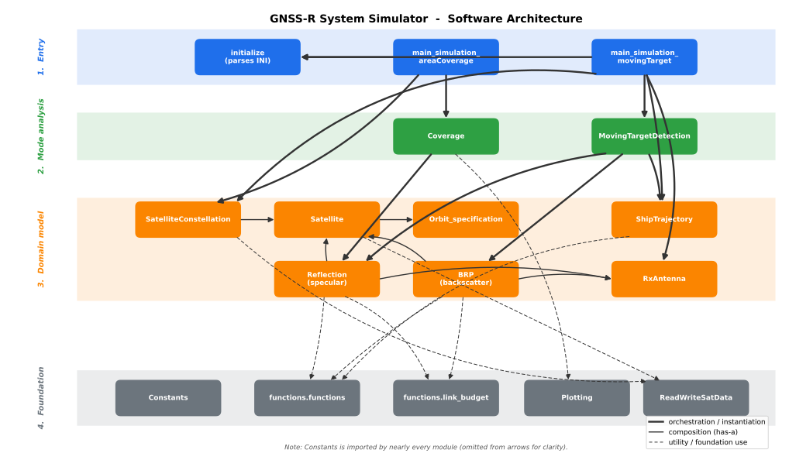

Architecture
============

Both analysis modes are built on the same core: the satellites, the reflection geometry, and the link
budget. This page illustrates how the different parts connect.

Shared core
-----------

Everything up to the reflection geometry is shared: both modes build and propagate the same
constellations and solve the same geometry:

- **Area coverage** counts contiguous specular-track visits over a grid. It has no detection threshold;
  link-budget finiteness is used only as an antenna/FOV validity gate.
- **Moving-target detection** follows a ship and scores each reflection, in specular or backscatter mode.

For the step-by-step flow, see :doc:`running`.

Software architecture
---------------------

   The modules in four layers. Thick arrows are instantiation, thin arrows composition, and dashed
   arrows foundation use. ``Constants`` is imported almost everywhere and is left out for clarity.

From top to bottom: the entry scripts and ``initialize`` (INI parsing); the two mode drivers
(:doc:`Coverage <Documentation/object_definitions/coverage>`,
:doc:`MovingTargetDetection <Documentation/object_definitions/moving_target_detection>`); the shared
domain model (satellites, reflection geometry, ship trajectory, antenna); and the foundation
(constants, link budget, helpers, IO), which is imported broadly.
