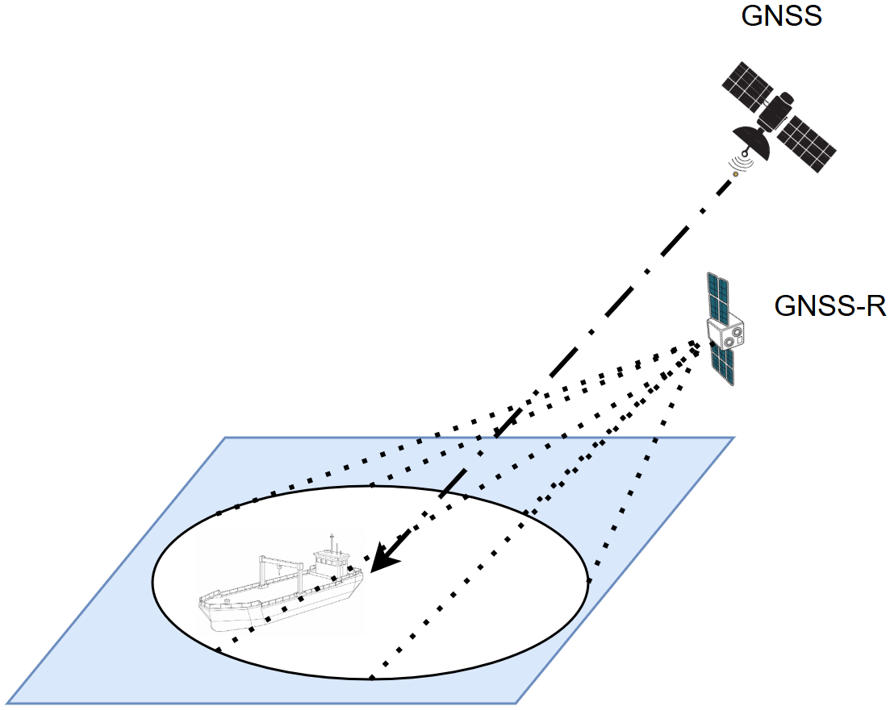

Backscatter mode
================

Summary
-------

In backscatter mode the signal comes almost straight back toward where it came from. The transmitter, the
surface point, and the receiver sit nearly on one straight line, so the wave is sent back along its own
path (a **retroreflection**). This is the geometry of ordinary radar: a ship is a hard, strong scatterer
that stands out against the weak return of the open sea.

This mode is used only by **moving-target detection**. It compares the modelled return from the ship
against the modelled return from the sea around it, giving a deterministic ship-versus-sea ratio.

The geometry
------------

   Retroreflection geometry. The GNSS transmitter, the surface point, and the GNSS-R receiver are
   nearly collinear, so the signal returns along almost the same path. A ship at the backscatter
   reflection point presents a strong return against the weak Bragg scatter of the open sea.

The surface point is the **Backscatter Reflection Point (BRP)**: the point where the straight line through
the transmitter and the receiver meets the Earth on the receiver's side. Writing that line through the
transmitter :math:`T` and receiver :math:`R`,

.. math::
   :label: bks-line

   \mathbf{P}(t) = T + t\,\hat{u}, \qquad \hat{u} = \frac{R - T}{\lVert R - T\rVert},

the BRP is the first place this line crosses the surface **beyond the receiver**. Putting
:math:`\mathbf{P}(t)` into the selected sphere or WGS-84 ellipsoid equation gives a quadratic in
:math:`t`; the accepted root must satisfy :math:`t>\lVert R-T\rVert`. The full solve, the incidence
angle, and the geometry gates are in
:doc:`../Documentation/object_definitions/backscatter_point`.

The sea return
--------------

Looking straight back at the sea, the bright quasi-specular scatter is gone -- no part of the surface is
tilted the right way to bounce the signal straight back. What is left is **Bragg** scatter: a weak,
resonant return from small wind-driven ripples whose wavelength matches the radar. The simulator computes
this with the two-scale model in :doc:`../Documentation/functions/ocean_physics`, and the resulting
cross-section per unit area (the NRCS) is multiplied by a clutter area to get the sea power.

That clutter area matters. The simulator can use the whole antenna footprint, patch-integrate over that
footprint, or use a first-order **delay-Doppler resolution cell**
(:doc:`../Documentation/functions/delay_doppler`). A smaller assumed cell can lift the modelled
ship-to-sea ratio substantially. The detector does not yet verify that a ship anywhere in the footprint
shares the reference point's delay-Doppler bin, so this option is a sensitivity study rather than complete
bin-level association.

Finding a ship
--------------

The ship's own return comes from its flat sides and its corner (dihedral) structures, which are strong
radar reflectors (:doc:`../Documentation/object_definitions/ship_target`). Because the ship and the sea
share the same path here, they can be compared directly. The simulator forms the signal-to-clutter ratio
and the signal-to-clutter-plus-noise ratio,

.. math::
   :label: bks-scr

   \mathrm{SCR} = \frac{P_\mathrm{ship}}{P_\mathrm{ocean}}, \qquad
   \mathrm{SINR} = \frac{P_\mathrm{ship}}{P_\mathrm{ocean} + N_\mathrm{eff}},

where the raw thermal-noise power is

.. math::
   :label: bks-noise

   N = k\,T_\mathrm{sys}\,B,

with Boltzmann constant :math:`k`, system noise temperature :math:`T_\mathrm{sys}`, and bandwidth
:math:`B`. The detector divides this raw floor by a detection-equivalent coherent/incoherent sensitivity
factor before forming :math:`N_\mathrm{eff}`. The :math:`\sqrt{M}` factor represents reduced estimator
variance, not reduced mean noise power. A detection is declared when the metric passes the configured
threshold.

Whether the implemented metric is noise- or clutter-limited depends on the receiver settings. The
:math:`B\,T_\mathrm{coh}\sqrt{M}` scaling is useful for comparative sensitivity studies, but without an
explicit test statistic, false-alarm probability and fluctuation model it is not a calibrated detection
probability.

What you get out
----------------

Per band, the detection events with their SCR and SINR, plus the per-event power breakdown (ship, sea,
noise), as footprint-overlap maps, link-budget breakdown plots, and an optional animation
(``OUTPUT/Footprint_overlap_backscatter_<CONST>_<band>_<contour>dB.png`` and
``OUTPUT/Link_budget_breakdown_backscatter_<CONST>_<band>_*.png``). See
:doc:`../Documentation/object_definitions/moving_target_detection`.

Where it lives in the code
--------------------------

.. list-table::
   :widths: 40 60
   :header-rows: 1

   * - Module
     - Role in backscatter mode
   * - :doc:`../Documentation/object_definitions/backscatter_point`
     - Finds the BRP and the incidence angle for each Tx/Rx pair.
   * - :doc:`../Documentation/functions/ocean_physics`
     - The two-scale Bragg backscatter that sets the sea clutter level.
   * - :doc:`../Documentation/object_definitions/ocean_target`
     - Wraps the sea NRCS and the clutter area into a radar cross-section.
   * - :doc:`../Documentation/functions/delay_doppler`
     - The delay-Doppler cell that sets the clutter area.
   * - :doc:`../Documentation/object_definitions/ship_target`
     - The ship radar cross-section (flat plates and dihedral corners).
   * - :doc:`../Documentation/functions/link_budget`
     - The bistatic radar equation behind the ship and sea powers.
   * - :doc:`../Documentation/object_definitions/moving_target_detection`
     - Matches reflections to the ship and computes the SCR / SINR.

Assumptions and limitations
---------------------------

- **Retroreflection geometry.** The BRP assumes the transmitter, surface, and receiver are collinear; this
  is the right point for backscatter, not the forward specular reflection point.
- **Noise- or clutter-limited by settings.** The detector applies the configured processing gain to the
  detection-equivalent thermal scale before forming SINR; the incoherent-look factor is approximate.
- **Bragg gating.** The Bragg return is added only near backscatter and at oblique incidence, so the
  forward path is left unchanged. Out-of-plane polarisation rotation is not yet included.
- **Coarse spatial match.** A reflection counts as "on the ship" when the point or its footprint overlaps
  the ship position.
- **No DDM bin association.** Footprint overlap is not proof that ship and ocean reference returns share
  one delay-Doppler bin.
- **Preliminary absolute RCS.** The box/dihedral ship model is useful for aspect trends but is not
  measurement-calibrated; absolute detection conclusions require an external RCS model or data.

When to use it
--------------

Use backscatter mode to study ship detection as a radar problem -- ship versus sea clutter. It needs the
incidence-angle gate as well::

   [REFLECTION]
   reflection_type = backscatter
   max_central_angle_deg = 45.0
   max_incidence_angle_deg = 70.0

References
----------

- Valenzuela, G., "Theories for the interaction of electromagnetic and oceanic waves -- a review",
  *Boundary-Layer Meteorology* 13, 1978 (Bragg scatter).
- Gleason, S. & Gebre-Egziabher, D. (eds.), *GNSS Applications and Methods*, Artech House, 2009.
- Clarizia, M. P. *et al.*, "Target detection using GNSS reflectometry", 2010s.
