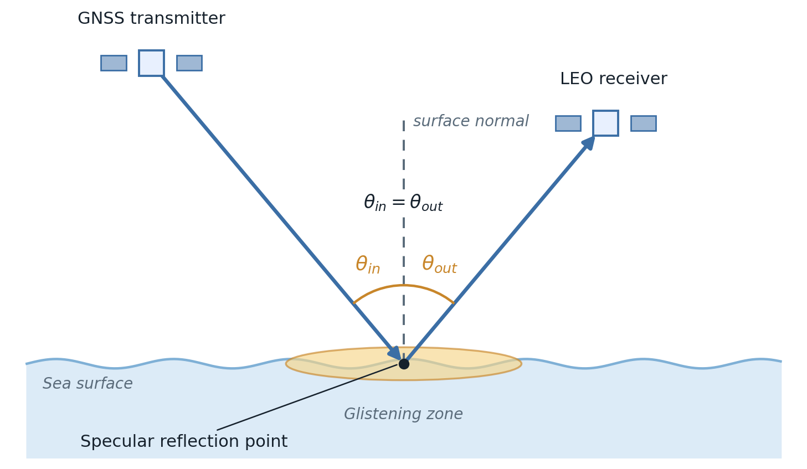

Specular (forward-scatter) mode
===============================

Summary
-------

In specular mode the forward-scattered GNSS signal is received and analysed. The **specular reflection point** is the
point on the sea surface where the angle of the ray coming in equals the angle of the ray going out.

The geometry
------------

   Specular (forward-scatter) geometry. The GNSS signal reflects once at the specular reflection point
   and continues to the LEO receiver. The incident and reflected rays make equal angles with the
   surface normal (:math:`\theta_{in} = \theta_{out}`), and the diffuse glistening zone extends to
   either side of the specular reflection point.

The specular reflection point obeys the **law of reflection**: the incoming ray and the outgoing ray make equal angles
with the local surface normal. Writing the incoming and outgoing unit directions and the surface normal at
the surface point :math:`S`,

.. math::
   :label: spec-dirs

   \hat{v}_{in}  = \frac{S - T}{\lVert S - T\rVert}, \qquad
   \hat{v}_{out} = \frac{R - S}{\lVert R - S\rVert}, \qquad
   \hat{n} = \hat{n}(S),

with transmitter :math:`T` and receiver :math:`R`, the equal-angle condition is

.. math::
   :label: spec-angles

   \cos\left(\theta_{in}\right) = -\,\hat{v}_{in}\cdot\hat{n}, \qquad
   \cos\left(\theta_{out}\right) = \hat{v}_{out}\cdot\hat{n}, \qquad
   \theta_{in} = \theta_{out}.

This point is located by the :doc:`../Documentation/object_definitions/reflection` solver, which provides
a closed-form solution for a spherical Earth and a two-angle stationary-path solve on the WGS-84
ellipsoid.

Around the specular reflection point the sea is not perfectly flat, so the reflection is not a single clean ray.
The signal also scatters from a bright patch of surface either side of the specular reflection point, the
**glistening zone**. That
spread-out return is the heart of GNSS-reflectometry.

The sea return
--------------

The power picked up at the receiver follows the bistatic radar equation
(:doc:`../Documentation/functions/link_budget`),

.. math::
   :label: spec-radar

   P_r = \frac{\mathrm{EIRP}\; G\; \lambda^2\; \sigma}{(4\pi)^3\, R_t^2\, R_r^2\, L},

where :math:`\sigma` is the radar cross-section of the sea, supplied by
:doc:`../Documentation/object_definitions/ocean_target`. In the specular direction the ocean model adds two
parts: a clean **coherent** specular reflection (which only matters for very calm water) and the diffuse
**incoherent** glistening-zone return (what you usually see).

Finding a ship
--------------

In specular mode a ship does **not** add a bright glint of its own (that forward glint is not modelled
yet). Instead the ship **shadows** the small patch of sea it sits on: the glint that patch would have sent
back is removed. So the thing to detect is a small **drop** in received power,

.. math::
   :label: spec-shadow

   \Delta P_r = -\,P_\mathrm{ocean}\left(A_\mathrm{ship}\right),

the sea-glint power over the ship's waterline area :math:`A_\mathrm{ship}` (length times beam). This signal
is faint by design. The simulator reports it on its own, as a fraction of the full-footprint glint, and
against the thermal-noise floor, with no flooring or inflation.

What you get out
----------------

- **Area coverage** -- a contiguous track-visit count per grid cell, per GNSS constellation, and a combined map
  (``OUTPUT/Coverage_grid_<CONST>.png``). See :doc:`../Documentation/object_definitions/coverage`.
- **Moving-target detection** -- the shadow change :math:`\Delta P_r` per band, reported against the noise
  floor in the link-budget breakdown, with footprint-overlap maps written as
  ``OUTPUT/Footprint_overlap_specular_<CONST>_<band>_<contour>dB.png``. See
  :doc:`../Documentation/object_definitions/moving_target_detection`.

Where it lives in the code
--------------------------

.. list-table::
   :widths: 40 60
   :header-rows: 1

   * - Module
     - Role in specular mode
   * - :doc:`../Documentation/object_definitions/reflection`
     - Finds the specular reflection point and the incidence angle for each Tx/Rx pair.
   * - :doc:`../Documentation/object_definitions/ocean_target`
     - The sea radar cross-section (coherent specular + glistening zone).
   * - :doc:`../Documentation/functions/link_budget`
     - The bistatic radar equation that turns geometry and RCS into received power.
   * - :doc:`../Documentation/object_definitions/coverage`
     - Accumulates contiguous specular track visits over a gridded region (area-coverage mode).
   * - :doc:`../Documentation/object_definitions/moving_target_detection`
     - Matches reflections to the ship and computes the shadow metric (moving-target mode).

Assumptions and limitations
---------------------------

- **No ship forward glint yet.** The ship is seen only through the sea patch it hides, not through a glint
  of its own, so the moving-target signal in this mode is small.
- **Footprint-overlap candidate.** The ship is associated by time and antenna-footprint overlap. Its own
  delay and Doppler are not compared with the reference bin.
- **First-order DDM singularity.** At the exact specular point the present delay-Doppler Jacobian is
  singular and falls back to the antenna footprint. A small specular cell requires a second-order delay
  model that is not implemented.
- **Specular geometry.** This mode locates the specular reflection point; the diffuse multipath and the exact extent of
  the glistening zone are handled by the ocean model, not resolved here.
- **Area coverage is geometry only.** The band's frequency and EIRP feed only the field-of-view gate, not a
  detection threshold, so the coverage result does not depend on the band -- only on which constellations
  take part.

When to use it
--------------

Use specular mode for standard reflectometry coverage studies, and to compare against existing GNSS-R
datasets. Set it with::

   [REFLECTION]
   reflection_type = specular
   max_central_angle_deg = 45.0

References
----------

- Zavorotny, V. & Voronovich, A., "Scattering of GPS signals from the ocean with wind remote sensing
  application", *IEEE TGRS* 38(2), 2000.
- Born, M. & Wolf, E., *Principles of Optics*, 7th ed., Cambridge University Press, 1999 (law of
  reflection, Fermat's principle).
- Ruf, C. *et al.*, "A new paradigm in earth environmental monitoring with the CYGNSS small satellite
  constellation", *Scientific Reports* 8, 2018.
