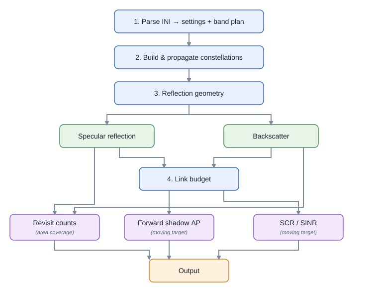

Running the simulator
=====================

The simulator has two entry points, one per analysis mode. Both read an INI file and **must be launched
from the repository root** (the constants resolve all data and output paths from the working directory).

.. code-block:: bash

   # from the repository root
   python SRC/main_simulation_areaCoverage.py     # reads Configuration_area.ini
   python SRC/main_simulation_movingTarget.py     # reads Configuration_ship.ini

Area coverage
-------------

``SRC/main_simulation_areaCoverage.py`` allows to evaluate *how often* a region is covered by reflections. It reads
``Configuration_area.ini``, builds the receiver and GNSS constellations, and runs
:doc:`Documentation/object_definitions/coverage` over a region predefined by a shapefile (path provided in ``Configuration_area.ini``). Outputs are per-constellation
track-visit maps in ``OUTPUT/``.

Moving-target detection
-----------------------

``SRC/main_simulation_movingTarget.py`` allows to evaluate *when* a moving target (e.g. a ship) could be detected by a reflection, and how likely it is to be detected (link budget). 
It reads ``Configuration_ship.ini``, builds a :doc:`Documentation/object_definitions/ship_trajectory`,
propagates the constellations, and runs :doc:`Documentation/object_definitions/moving_target_detection` in
either ``specular`` or ``backscatter`` mode. Outputs are per-band detection plots (and an optional
animation) in ``OUTPUT/``.

Processing pipeline overview
----------------------------

   The processing flow. The core is shared; the two reflection modes share the link budget but
   produce different detection metrics, and area coverage counts contiguous track visits from the specular geometry
   alone (it skips the link budget).

Both modes share the same core. The processing flow is:

#. parse the INI (:doc:`Documentation/configuration`) into settings and a validated band plan;
#. build the LEO receiver constellation and the GNSS transmitter constellations
   (:doc:`Documentation/object_definitions/satellites`) and propagate them;
#. solve the reflection geometry per (transmitter, receiver) pair
   (:doc:`Documentation/object_definitions/reflection` or
   :doc:`Documentation/object_definitions/backscatter_point`);
#. evaluate the link budget (:doc:`Documentation/functions/link_budget`) using the ocean and ship RCS
   models (:doc:`Documentation/object_definitions/ocean_target`,
   :doc:`Documentation/object_definitions/ship_target`);
#. accumulate coverage counts or detection events and write the plots.

.. note::

   The first launch in a fresh session can pause for several seconds while ``astropy`` (pulled in by
   ``pymap3d``) imports cold and the antivirus scans the scientific libraries; the second run is fast. Use
   *Run Without Debugging* in the IDE, or pre-warm the import once, if the debugger surfaces an interrupt
   during that import.

.. caution::

   ECI/ECEF conversion depends on Earth-orientation data from ``astropy-iers-data``. Offline execution is
   allowed to use the installed table even when its predictive portion is stale, which favors
   reproducibility over a hard failure. Update ``astropy-iers-data`` (or provide current IERS data) before
   precision geolocation studies, especially for future dates.
